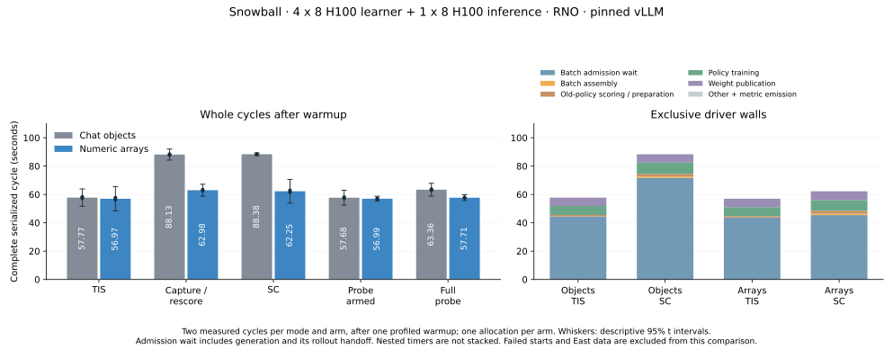

# Native score-centering integration

The native task adapter can carry K128 behavior heads as numeric arrays through the pinned vLLM engine API.
vLLM still renders messages, parses tools, samples tokens and handles aborts. Our adapter asks its public
`generate` interface for flat logprobs and attaches the selected arrays to the internal Ray response. It avoids
constructing, serializing and reparsing one chat object per candidate. Public HTTP chat responses keep their
existing shape. This record contains the completed Qwen interface qualifications and matched Snowball controls.
Real-reward asynchronous throughput remains pending.

The [prior performance evidence](../score_centering_performance/README.md) remains unchanged. The active
product is [draft #968](https://github.com/marin-community/MarinSkyRL/pull/968); #996 remains research.
The dependency stays at vLLM `39e62869693c46402b1a95fde4fc55ca1aab9ae1`. The qualified serving and token-version
hooks are unchanged. No new vLLM subclass, override, monkey patch, fork patch or dependency upgrade is used.

## Source and controls

| Purpose | Product | Instrumented runtime |
| --- | --- | --- |
| Qwen prototype qualification | `d92307d3deff81aa8270c90c49d529a9bb7a1951` | `328858aa5ad1f659ee1bb6bf60aa6187be973512` |
| Qwen boundary-corrected qualification | `db5227d4814086c5a71ca669b8c0dbb19563705b` | `a3cf30b6598de5a6de8ca45e720d5db8c47784d0` |
| Snowball prior integration | `964a602e995b16943dc34db036d25d2b7c5b7310` | `bdb8b3134ca0b7322d889f2634dd1bfc6a126beb` |
| Current Qwen/Snowball candidate target | `87f13fcd82b4677545816e0789c685d10cf051a0` | `92d057c561b0893a3d922e42f221eb8d5b1e68fb` |
| Original Snowball staged async baseline | `964a602e995b16943dc34db036d25d2b7c5b7310` | `3b5de0c201a8ab7034aa53d9be3645d1e5372a8b` |
| Repaired async baseline | `964a602e995b16943dc34db036d25d2b7c5b7310` plus common grader repair | `dffd2c4b318bad910e532dea19f05a3cc1f9916e` |
| Repaired async candidate | `c36e8594cbbbe55362945debfa6f75887a96361f` | `56e187219994288b50463d8505f822329beb0795` |

The later product commit `c44e390a5236079b116c28dc27f84db2ec90c2cb` adds a structural sampling type; its
generation and selection operations are unchanged. Runtime-only measurement code stays outside the product
PR. [The harness proof](evidence/matched-harness-proof.json) checks identical benchmark files, inference
measurement methods, lock and task image between the Snowball arms.

[The initial protocol](protocol.json) records the Qwen exposure. [The first Snowball protocol](snowball-protocol.json)
records final pins before its first submission; [revision a1](snowball-protocol-a1.json) extends future queue deadlines
after a provider preemption. [Revision a2](snowball-protocol-a2.json) moves the sequential comparison to East
after a second preemption and declares one additional baseline attempt. Each Snowball arm uses five BATCH nodes, with four 8-H100
learners at PP2/EP8/DP16, TP/CP/SP1, and one 8-H100 inference node at DP8/EP8. It retains the Snowball 67B/A2B
SFT checkpoint and tokenizer revision from the prior evidence. The real grader preflight reproduced all 192
selected tasks, their order and their source hash, including the ten incompatible references excluded before
generation. No source rows were edited.

The original whole-run protocol declared 87 applied updates: three calibration updates, five serialized modes with six rotating
repetitions each, six natural-reward periodic updates and four asynchronous modes with twelve updates each.
Serialized modes are ordinary TIS, capture/rescore with SC off, SC on, probes armed without an observation,
and a complete probe. Its interrupted East baseline retained one profiled warmup and two complete measured rotations per mode. The controlled batch
contains 128 responses of mixed lengths through 4096, 174080 response tokens and 164484 loss tokens, with
padding, mask holes and one empty-loss row.

Asynchronous modes use ordinary TIS, capture/rescore, SC and interval-ten probes. They retain real task rewards,
normal EOS, applied updates, per-update weight publication, full-batch admission, maximum source age four and
64 in-flight groups. Two warmup updates precede ten measured updates per mode. Continuous arm walls include
ordinary bookkeeping; profiles, forced memory synchronization, initial warmup and final context teardown stay
outside these windows. Prefetch at finite boundaries, ordered modes, changing weights and response variation
limit inference from a short comparison. No learning benefit is claimed.

The first Snowball attempt had a 10800-second queue-inclusive deadline. Future submissions use 21600 seconds,
with the same finite measurement windows, zero automatic failure or preemption retries and an initial manual
limit of two attempts per arm. Matched arms use the same cluster sequentially. Provider admission,
task state and verified Pod absence determine allocation accounting; Iris RUNNING alone does not prove admission.

Baseline a0 waited 40 minutes for RNO admission at 16:55:59 UTC. Kueue evicted its driver at 17:05:08 to admit
another workload; all five tasks became terminal by 17:05:41 and their Pods were absent at 17:11:26. No report
was written. The harness writes its first report before its first optimizer update, so this was a startup-only
attempt with zero applied updates. Baseline a1 was admitted at 17:49:11 UTC and evicted three seconds later;
its tasks were terminal by 17:49:51 and Pods absent at 17:51:24. It also produced no report or update.
After both old queues and Pods were verified stopped, baseline a2 was submitted to East at 17:55:35 and admitted
at 18:09:47. A priority-11 workload preempted it at 18:44:49; all tasks were terminal at 18:45:25 and Pods absent
at 18:56:34. It saved 20 applied updates and 17 complete serialized cycles. The next in-flight update is unestablished.
Config suffixes in the original protocols name revisions, not actual submitted attempts.
[Allocation accounting](allocation-accounting.json) includes failed starts, queue time and teardown bounds.

[The staged protocol](snowball-staged-protocol.json) was frozen before any candidate Snowball result. It retains
the baseline's last complete balanced rotation: 15 cycles, with warmup and two measured repetitions per mode,
through applied update 18. The two complete cycles from the interrupted next rotation remain in the original
raw report and are excluded from the primary matched comparison. The candidate controls stage repeats those
same 18 updates. Two measured repetitions give wider descriptive intervals than the original five.

Separate baseline and candidate asynchronous stages start from the same original SFT checkpoint. Each performs
three calibration updates, six natural periodic updates and 58 asynchronous updates, for 67 total. Ordinary,
capture and SC modes each have two warmup and ten measured updates. The interval-ten probe arm has two
warmup and twenty measured updates, spanning two cadence intervals. The original per-update
measurement functions, serialized loop and periodic body are AST-identical; see
[the staged harness proof](evidence/staged-harness-proof.json). No partial training checkpoint is recovered.
That initial plan kept all three future stages on East, sequentially, with at most two actual submissions each, a
21600-second queue-inclusive deadline and zero automatic retries. Product code, K128, SC application frequency
and the asynchronous admission/publication controls are unchanged.

Candidate controls a0 was admitted at 19:44:38 UTC, then preempted by a priority-12 workload at 19:49:18,
before its first report or optimizer update. All tasks were terminal at 19:49:52 and Pods absent at 20:02:01.
The remaining controls retry is prepared but held until East has room for five whole nodes and sufficient
admission quota. [The stage attempt record](snowball-stage-attempts.json) keeps this failed start and the
remaining limits explicit. Both asynchronous stages remain unsubmitted. No candidate Snowball performance
or correctness result is established yet.

[Revision r2](snowball-staged-protocol-r2.json) moves both primary comparison arms to RNO after a fresh check
found seven whole-node fits, 69 GPU/RDMA units of unused quota and no pending workloads. All old East jobs and
queues were already absent. It declares a fresh 18-update baseline controls stage and the remaining candidate
controls retry there, followed by the two 67-update asynchronous stages. The East prefix becomes secondary
evidence and is not pooled with RNO. The new short baseline stage allows two actual submissions; the candidate
controls limit remains two including its spent East attempt. [The additional Qwen protocol](qwen-floor-protocol.json)
declares one source-correction qualification, the third and final Qwen attempt, before candidate Snowball.

After corrected-source Qwen success and shutdown, the [baseline queue checkpoint](snowball-baseline-queue-checkpoint.json)
allows its first bounded controls attempt to wait in the native gang queue without an immediate free-node fit.
This catches admission openings between manual checks. It consumes no GPUs while pending and keeps the same
five-node BATCH geometry, six-hour queue-inclusive deadline, two-attempt stage limit and zero automatic retries.
The final candidate controls retry remains unsubmitted until the baseline qualifies and stops.

The fresh RNO baseline controls completed all 18 updates and 15 serialized windows. All five tasks succeeded on
attempt zero by 22:05:07 UTC on October 19; their Pods and queue were absent at 22:07:35. Full-normalization
references at both temperatures were within 1.91e-6. The complete raw report is retained in
[reports](reports/), with a [standalone analysis](evidence/snowball-baseline-controls-a0-rno-analysis.json).
The matched candidate controls was submitted at 22:08:42.249 UTC and admitted at 22:08:42.621248. Its actual
task and logshipper images match the baseline and corrected Qwen run. It saved three calibration updates and
the ordinary warmup, then a 600-second guard expired waiting for capture-cycle batch admission. All 128 trials
finished with the expected lengths, valid masks and no task error. Twenty-five groups committed payloads;
seven long-response groups did not. All tasks were terminal at 22:38:08 and Pods absent at 22:46:07.
[The failure record](evidence/snowball-candidate-controls-a1-rno-failure-summary.json) retains the incomplete
report, native outcomes, regional telemetry and task archives. Its exact handoff-stall cause is unresolved.
The baseline and failed candidate a1 used ordinary BATCH priority; native Kueue admitted them by preempting priority-one workloads.
No priority or shared-service setting was changed. Candidate results and both asynchronous stages remain pending.
[The earlier documentation-head CI](evidence/pr968-097192b4-ci-check-03.json) is terminal with all six checks successful on
product `097192b463e48552383fe27fc8c42b135bf2c20a`, whose only difference from qualified source `87f13fcd` is documentation.

[Revision r3](snowball-staged-protocol-r3.json) moves one reserved candidate asynchronous retry to one additional
controls attempt. The global candidate limit stays four: three controls attempts, including both spent starts,
and one asynchronous submission. No attempt is reset. A CPU replay wrote and read eight exact 17 MB native
payloads through the pinned storage path in 4.935 seconds and verified every hash; this does not reproduce the
failed worker stacks or establish training throughput. The future window guard is 1800 seconds, allowing the
existing 600-second S3 request deadline and retry path to surface. Both unsubmitted asynchronous arms receive
the same guard. Source, workload, sampling, K128, cadence and measurement windows remain unchanged. If the
controlled warmup stalls again, capture live worker stacks before its guard; keep extra profiling out of real
asynchronous throughput windows. No further undeclared controls retry is armed.

Candidate controls a2 completed all 18 applied updates and 15 serialized windows. All five tasks succeeded on
attempt zero by 23:51:03 UTC, and Pods and queue were absent at 23:54:27. Its three full-normalization reference
sets, including the native compact-position temperature-0.7 check, were within 1.91e-6. The declared warmup
profiles were sufficient; no extra diagnostic capture was needed. Both primary controls reports are complete.

The first fresh asynchronous baseline was submitted at 23:57:02.376 UTC and admitted at 23:57:02.812013 on October 19.
A priority-12 workload evicted it at 00:01:05.666032 on October 20, before its first report or optimizer update.
The preemptor's owner is unknown. All tasks were terminal by 00:01:38.958, and Pods and queue were absent at
00:15:45.497607. Its zero updates and allocation time remain in the attempt record.

The second baseline asynchronous attempt, last under r3, was submitted at 00:21:53.775 UTC on October 20
and admitted at 00:21:55. It changes only the run namespace from the first attempt. It starts from the original
SFT checkpoint and plans 67 applied updates with real task rewards, normal EOS and per-update publication.
It was preempted by another priority-12 workload at 00:26:51.532574, before its first report or update. All tasks
were terminal at 00:27:29.173; Pods and queue were absent at 00:32:13.318884. All twelve actual GPU submissions
are now closed. The preemptor's owner is unknown.

[Revision r4](snowball-staged-protocol-r4.json) moves the unused baseline-controls retry to one final asynchronous
baseline attempt. The overall baseline limit remains seven; the candidate limit remains four, with one
asynchronous submission left. A fresh capacity guard requires five free whole H100 nodes and 40 unused GPU/RDMA
quota units. Choose the first fit on RNO or East, then keep both asynchronous arms on that cluster. The completed
RNO controls remain separate. This changes only the run namespace and optional cluster route. It preserves all
r3 training and measurement settings, including fresh SFT, real rewards, 67 applied updates and zero automatic
retries. Check clusters sequentially with longer waits while unchanged; reassess after the four-hour capacity
window at 04:34 UTC. No further GPU job is submitted until the capacity guard is met.

[Revision r5](snowball-staged-protocol-r5.json) follows the four-hour readiness window, which ended without a
five-node opening. At 04:34 UTC, RNO held 408 GPUs in admitted priority-12 workloads and another 120 requested
by pending priority-12 work. East had no priority-12 workload. Both had zero free whole-node fits. The final
baseline async attempt will enter East's native BATCH queue, then the candidate will use the same cluster after
verified baseline shutdown. This replaces the derived free-only guard and catches openings between checks.
It adds no attempt and changes no training setting. Queue-inclusive deadlines remain six hours, with zero
automatic retries. The controlled RNO and asynchronous East timing samples will remain separate.

The final baseline async job was submitted to East at 04:36:07.291 UTC. At 04:36:24 all five Pods were pending;
Kueue needed 33 more GPU/RDMA quota units. This is actual submission thirteen, baseline submission seven of
seven, including all queue/startup failures. The queue-inclusive deadline is 10:36:07.291 UTC; no automatic retry
is enabled. Candidate async remains unsubmitted, with one submission allowed after baseline completion/release.

East admitted the baseline at 05:58:03.244151 UTC after 82 minutes in queue. A priority-11 workload preempted it
at 05:59:44.252496, 101 seconds later, before any report or update. Controller terminal was 06:00:00.030; all
Pods and queue were absent at 06:01:52.272332. The preemptor owner and live container images were not observed.
All thirteen actual submissions are closed.

[Revision r6](snowball-staged-protocol-r6.json) explicitly declares one additional fresh baseline attempt after
three external asynchronous startup preemptions. It raises the overall baseline allowance from seven to eight;
the candidate allowance stays four. The original goal has no GPU-hour cap. Every spent attempt remains counted,
and no automatic retry is enabled. This changes only the run namespace; the model, source, task/reward behavior,
67 updates, batch geometry, K/cadence and six-hour queue-inclusive deadline are unchanged. The candidate still
requires a complete fresh East baseline and verified shutdown before submission.

The r6 baseline was submitted at 06:06:14.078 UTC and admitted at 06:06:14.372367. All five East Pods were
Running on attempt zero by 06:07:13, with the same task and logshipper images as the complete controlled pair.
This is actual submission fourteen, baseline submission eight/eight. It plans 67 fresh real-reward updates with
a queue-inclusive deadline of 12:06:14.078 UTC and no automatic retry. The candidate is still unsubmitted.

The r6 baseline saved nine applied updates: three calibrations and six real-reward periodic updates, each with
a nonzero gradient. It failed at the first asynchronous admission before optimizer update ten. Native metric
logs end at step nine. The existing AIME grader raised a SymPy matrix/scalar `TypeError`. The original answer
was not retained; a CPU square-root-of-matrix candidate reproduces that failure mode during finiteness validation.
Controller terminal was 06:26:13.274 UTC, with verified absence at 06:30:51.606126. All fourteen submissions are
closed. No asynchronous throughput estimate comes from this failed run.

[The failure and repair record](evidence/snowball-baseline-async-a3-east-failure-summary.json) links the partial
report, native errors and bounded-grader regression. Marin commit `5ef1e703d3bae94d510d8cf3f50d902958e10d20`
adds one scalar validation predicate before the failing finiteness query. Unsupported candidates still receive
the existing zero-credit result; invalid references fail validation. The regression failed before the change;
437 affected grader tests pass after it. Product commit `c36e8594cbbbe55362945debfa6f75887a96361f` pins that exact
repair and passes 477 CPU checks with three dependency skips. The lock changes only four shared Marin Git
revisions; the other package trees, versions, wheels and vLLM pin are unchanged. Both next fresh asynchronous
arms will share this repair. Their timings remain separate from completed RNO controls at the prior grader revision.

[Revision r7](snowball-staged-protocol-r7.json) declares one fresh repaired asynchronous pair. It explicitly
raises the agent's baseline submission allowance from eight to nine; the candidate allowance remains four.
Both arms use the same grader repair and lock. Their training and measurement functions are unchanged;
[the runtime proof](evidence/matched-grader-runtime-proof.json) checks this against the prior instrumented
heads and confirms the other three shared Marin package trees are identical. Both actual backend dry runs
passed without submission. All fourteen prior allocations remain counted and closed.

[The real-source task replay](evidence/grader-repair-task-parity.json) confirms exact old/new grades for all
192 fixed reference-like replies. There are 191 positive replies and one existing negative symbolic-inequality
format case at campaign source row 8692, whose reference is `d < \mu < M`. The legacy extraction stops at a
literal `<`, and equivalent escaped forms also fail its literal symbolic comparison. This existing limitation
is preserved: no task is edited or filtered. The repair also grades a known matrix-root wrong candidate
incorrect in all 145 AIME sessions. This is a regression and parity check, not evidence of model answer quality.
The [replay archive](evidence/grader-repair-task-replay.zip) preserves complete CPU outputs and the helpers.

The baseline must complete all 67 fresh applied updates and stop before the one candidate submission. Each
uses East BATCH priority, five eight-H100 nodes, a six-hour queue-inclusive deadline and zero automatic retries.
Fresh board and sequential capacity checks precede submission. Both complete asynchronous reports and the
final goal review remain pending.

[Revision r8](snowball-staged-protocol-r8.json) routes both still-unsubmitted repaired asynchronous arms to
Reno. The sequential capacity check found seven free whole H100 nodes and 71 unused GPU/RDMA quota units
there, versus one node and 15 quota units on East. All fourteen prior jobs were absent on both clusters.
The change affects only the cluster route and run namespace. R7's source pins, task/measurement settings,
submission limits and deadlines are unchanged. Complete controls and fresh repaired async results remain
separate stages, even though both use Reno. Both actual Reno backend dry runs passed without submission. No repaired GPU attempt has yet been submitted.

## Complete controlled Snowball cost

[The primary matched analysis](evidence/snowball-controlled-cost-matched-rno.json) uses one RNO allocation per
implementation, with one profiled warmup and two measured rotating cycles per mode. It excludes East and failed
starts. Both arms used the same task image, packages, checkpoint, tokenizer, tasks, sampling, topology and
174080-response-token / 164484-loss-token batch. All included cycles finished within the original 600-second guard.

| Mode | Prior chat objects, seconds | Numeric arrays, seconds |
| --- | ---: | ---: |
| Ordinary TIS | 57.766 | 56.970 |
| Capture/rescore, SC off | 88.132 | 62.982 |
| TIS + SC | 88.381 | 62.248 |
| Probes armed, no observation | 57.683 | 56.993 |
| Complete probe | 63.356 | 57.706 |

SC cycles are 29.57% shorter, with a descriptive Welch log-time interval of 19.51% to 38.38% shorter. Relative
to ordinary TIS within each allocation, SC adoption overhead falls from 53.00% to 9.27%; the new paired
descriptive interval is 7.40% to 11.17%. Normalizing both allocations to their ordinary TIS cycles gives a
28.59% reduction in the SC/ordinary ratio, with a descriptive interval of 21.29% to 35.20%. These are small-sample
descriptions of this controlled workload, not population confidence or asynchronous throughput results.

The exclusive SC batch-admission wait falls from 71.69 to 45.42 seconds. That wait includes generation and its
rollout handoff. The remaining array SC cycle spends about 1.12 seconds assembling the batch, 1.91 preparing
old-policy scores, 7.65 training and 6.13 publishing weights. Full capture/rescore and SC have nearly the same
cost; their small observed difference is unresolved by two repetitions. Nested timers and concurrent actor
profiles are retained separately and are not added to these exclusive walls.

During the profiled SC warmup, the prior frontends made 128 chat-logprob builder calls and 174080 per-token
head-formatter calls. Both are absent from the array path. Its numeric selector ran 128 times, with 3.03 seconds
of cumulative time summed across concurrent frontends. Native sample-logprob updates still ran 174080 times.
These call-tree totals overlap and are not cycle walls. The CPU/Ray evidence below isolates representation and
transport costs; the complete cycles establish their practical serialized effect.

The full probe captured 16384 engine response tokens and produced 96 valid sampled positions after masks.
At interval ten, combining armed and complete-probe cycles gives a modeled 0.166% overhead and 570.64 seconds
between observations. Its paired descriptive interval is very wide, -15.84% to 19.23%, with only two repetitions.
This does not establish a sub-1% ceiling. Cadence remains ten, K128 and 32 exported positions per response.
Actual asynchronous coverage and elapsed time between consumed observations remain to be measured.

Both arms retain three 256 MiB dense head matrices in the full-SC optimizer batch: IDs, behavior scores and
old-policy scores. Learner peak allocated memory is 55.53 GiB in both arms; inference peak allocated memory is
58.31 GiB in both. Driver RSS after SC is 8.35 GiB with objects and 7.22 GiB with arrays, but the ordinary TIS
snapshots also differ (7.35 and 6.44 GiB). Cumulative frontend peaks include earlier qualification work and do
not isolate the formatter's transient heap. Cached/device-used peaks vary; no GPU memory reduction is established.

The first RNO candidate handoff timeout remains an unresolved operational observation. Its incomplete report,
normal task records and allocation cost remain separate; the completed follow-up used unchanged source.
No failed or incomplete cycle contributes to the table. Real-reward asynchronous throughput is still pending.

The corrected source reproduces the pinned chat formatter's -9999 score floor before token-ID tie ordering.
Without it, a head concentrated on one token could select different IDs when the remaining scores become ties
under the display floor. Two regression cases failed before the fix; 126 adapter checks now pass. Four independent
comparisons with the actual pinned Pydantic formatter, including sampled scores and the display limit, match exactly.
[The floor proof](evidence/chat-floor-after-proof.json) retains the source hashes and synthetic contract cases.
Raw-generation selection and the SC kernel are unchanged. Actual Qwen qualification of this corrected source
completed all 35 updates; Snowball qualification remains pending. Earlier qualified source pins remain separate.

## Qwen interface qualification

The corrected-source two-node RNO Qwen run completed 35 applied updates, all ten serialized windows, six natural periodic updates
and sixteen asynchronous updates. Exact old/new chat comparisons passed at temperatures 1.0 and 0.7 for both
128-token and 4096-token responses: token IDs, message, finish reason, source versions and chosen/head scores
matched. The compact response held int32 IDs and float32 scores, with display logprobs absent. Full-vocabulary
causal references, raw flat/dictionary parity and compact-position references also passed.

For a 4096-token response at temperature 1.0, a cross-node Ray echo carried 19270645 bytes as chat objects or
4268171 bytes as arrays. Three actor round trips were 0.686/0.674/0.686 seconds and 0.0196/0.0174/0.0172 seconds,
respectively. At temperature 0.7 they were 0.692/0.640/0.668 and 0.0196/0.0206/0.0189 seconds. These include actor
serialization, host copies and transport in both directions. They exclude generation, S3 and learner work;
halving or adding them to another timer would not measure a complete training cycle.

An earlier Qwen run exercised the prototype's collection width of 128. An independent CPU BF16 boundary check later
found three of 32 cases where collecting one fewer natural candidate changed the identity of an equally probable
head token. The final implementation restores the old collection width of 129 and reproduces the chat display
limit before selecting K128; all 32 cases then matched exactly. The corrected check supersedes an invalid scratch
reference, as recorded in [the boundary evidence](evidence/chat-collection-width-tie-proof.json). Both later Qwen
runs repeated all four comparisons at their respective corrected source pins and passed exactly.

All three complete raw reports are compressed without editing in [reports](reports/). The final report's original SHA-256 is
`02d80e1877adf95f0d97419e7a1cf18afef3573b00ed4df4d76e0e28b72eed8f`.
[The manifest](manifest.json) retains source locations, sizes and hashes. Both final Qwen tasks succeeded with
attempt zero; a fresh provider check verified their absence at 20:55:37 UTC on October 19. The task image and
Python package versions match the prior qualification. The cluster logshipper changed externally to `088139e5`;
both actual images are retained in the provider evidence, and fresh primary Snowball arms will record theirs.

The [current scalar replay](evidence/qwen-floor-a2-probe-precision.json) matches recorded values within 1.63e-9
using the independent FP32 formula; FP64 evaluation of the same quantized heads differs by up to 5.40e-5.

An [offline precision audit](evidence/qwen-final-a1-probe-precision.json) retains a limit of the existing SC kernel.
An independent FP32 current-equals-old formula reproduces held probe scalars within 2.6e-9. FP64 evaluation of the
same quantized heads differs by as much as 0.002755 in an artificial temperature-0.7 warmup with 21 valid positions,
all at the modeled tail floor. Using the FP32 tail coefficient in otherwise-FP64 arithmetic reduces that difference
below 1.6e-8. Subtracting near-unit head mass makes this tiny tail sensitive to rounding. The kernel is byte-identical
to the baseline; native old/new heads matched exactly. No kernel, modeled tail floor, tolerance or K was changed. This scalar
precision observation does not establish a parameter-gradient error or learning impact.

## CPU evidence and remaining transfers

Before the score-floor follow-up, the selector passed 441 CPU inference, trajectory and independent SC checks, with three dependency skips.
Another 25 checks cover probe scheduling, native rollout context and unchanged SC-off optimizer behavior.
The type-only follow-up passed 124 targeted adapter tests; the score-floor correction passed 126. Tiny-training and CatCount explicitly disable
probes; their settings and sampling are unchanged.

A CPU representation experiment repeats 24 retained Snowball causal heads to 4096 positions at K128. It uses
the exact pinned Pydantic classes, formatter, qualified ID-only hook and prior parser. Across five alternating
measured repetitions after warmup at the corrected source, median representation/pickle/client time was 3.410 seconds for chat objects
and 0.0651 seconds for arrays; pickle sizes were 19210004 and 4231457 bytes. Inputs and returned numeric values
matched exactly. Flat primitive lists were prebuilt, so this excludes GPU probability collection, flat-list append,
real Ray/S3 and training. The shared host also limits interpretation of CPU timing.

vLLM's existing API still returns CPU `FlatLogprobs` lists. Our selector packs owned NumPy arrays, which cross
Ray to task workers. The existing rollout path projects them into aligned arrays, stores trainable groups using
its existing S3 pickle store, collates padded learner tensors, and transfers the required tensors to learner GPUs.
Those stages remain in complete native cycles. Response text still needs detokenization; chosen-only TIS uses
the existing chat path. No new serving or storage system is introduced.

The authors' [top-k collector](https://github.com/martin-marek/score-centering/blob/7c56e9ee2972aa57f446cf564de1a1658d14b321/models/topk.py)
buffers 32 decode steps on GPUs, batches local/global top-k selection, and reshards compact arrays into the
trainer layout. Their sampler and trainer share a GPU pool sequentially. Dedicated inference and learner nodes,
host lists, Ray and durable rollout storage impose different transfers here. The paper's custom-JAX under-1%
result does not measure vLLM integration overhead. Upstream
[AuxOutput logprob work](https://github.com/vllm-project/vllm/pull/60789) rejects online weight updates in its
documented contract and was closed on October 19; it is not adopted by this integration.

`analyze.py` checks complete worker reports and the declared complete rotations from the interrupted baseline.
It produces serialized, asynchronous, memory and cadence summaries. Asynchronous summaries also count
nonzero gradients from ordinary retained metrics, consumed stop reasons and exclusive phase walls. These
explain applied updates and workload variation without adding a gradient diagnostic campaign.
It reuses the retained independent NumPy FP64 scalar replay and descriptive paired/Welch log-time comparisons.
Only exclusive StepWallTime fields partition a cycle. Nested timers and process CPU profiles can overlap.
Two measured Snowball repetitions per mode and one allocation per implementation do not measure
allocation-to-allocation variance. Control and asynchronous stages have separate allocations and training
trajectories; their timing samples are not pooled.
